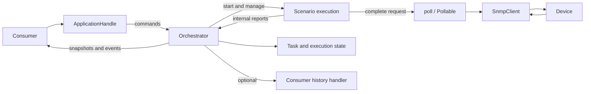

# traffic-engineer-tools Architecture

This file is the primary reference for the purpose of components and how they interact.
It describes the current state of the code, primarily the monitor in `tools-core`.
When a component's responsibility or contract changes, the corresponding section must be
updated together with the code.

The description below is verified against the current working tree.

## Contents

- [Purpose and project boundaries](#purpose-and-project-boundaries)
- [Monitor component map](#monitor-component-map)
- [Task description and configuration validation](#task-description-and-configuration-validation)
- [Build, start, and shutdown](#build-start-and-shutdown)
- [Orchestrator and internal state](#orchestrator-and-internal-state)
- [Scenarios](#scenarios)
- [Preparation stages and immediate logging](#preparation-stages-and-immediate-logging)
- [Requests, attempts, and SNMP](#requests-attempts-and-snmp)
- [Repeating-request schedule](#repeating-request-schedule)
- [Limit, results, and task history](#limit-results-and-task-history)
- [Events, snapshots, and subscriptions](#events-snapshots-and-subscriptions)
- [Event history output](#event-history-output)
- [Errors and restarts](#errors-and-restarts)
- [Coordination](#coordination)
- [How to extend the library and this document](#how-to-extend-the-library-and-this-document)
- [Open questions and checks](#open-questions-and-checks)

## Purpose and project boundaries

The main product is a reusable library for the traffic engineer: network polling and
device management, calculations, and data transformations. A library consumer may have
their own interface and storage.

| Crate | Purpose |
|---|---|
| [`tools-core`](crates/tools-core/src/lib.rs) | Domain types, monitor, SNMP, polling, converters, and other tools without a UI |
| [`tctl`](crates/tools-cli/src/main.rs) | The current CLI implementation: loads configuration, manages the session, and displays results |
| `net-monitor` | A separate frozen service; development of the `tools-core` monitor does not depend on it |

The planned axum application will be yet another consumer of the core.
Neither the CLI nor a future HTTP interface defines the boundaries of the library's
public API. Parsing the external format and presenting errors belong to the interface;
correctness rules for domain values belong to the core.

## Monitor component map

The public entry point is `tools_core::monitor`.
It re-exports configurations, management, results, events, and errors.
The internal `runtime`, `task`, and `scenario` modules are hidden behind this boundary.
The individual request and SNMP mechanisms are also available through
`tools_core::polling` and `tools_core::snmp`.

| Component | Responsibility | Source |
|---|---|---|
| `AppConfig` | Global settings: event-history output and restart policy | [runtime/app.rs](crates/tools-core/src/monitor/runtime/app.rs) |
| `TaskConfig` | The validated description of one task | [task/config.rs](crates/tools-core/src/monitor/task/config.rs) |
| `Application` | A prepared monitor before it is started | [runtime/app.rs](crates/tools-core/src/monitor/runtime/app.rs) |
| `RunningApplication` | Owns the background execution and its termination | [runtime/app.rs](crates/tools-core/src/monitor/runtime/app.rs) |
| `ApplicationHandle` | Cloneable access to commands, snapshots, and subscriptions | [runtime/app.rs](crates/tools-core/src/monitor/runtime/app.rs) |
| `Orchestrator` | Internal owner of task state, their lifecycle, and event ordering | [runtime/orchestrator.rs](crates/tools-core/src/monitor/runtime/orchestrator.rs) |
| `Task` | Internal configuration, revision, results, metrics, and health of a task | [task/task.rs](crates/tools-core/src/monitor/task/task.rs) |
| `TaskProgress` | Scenario-authored preparation activity text and its source timestamp | [task/view.rs](crates/tools-core/src/monitor/task/view.rs) |
| `PreparationEvent`, `PreparationReport`, `PreparationView` | Live preparation stages, complete preparation evidence, and snapshot progress | [preparation.rs](crates/tools-core/src/monitor/scenario/preparation.rs) |
| `ScenarioSpec` | Public description of the selected scenario | [scenario/spec.rs](crates/tools-core/src/monitor/scenario/spec.rs) |
| GET/SET execution | Request preparation, schedule, commands, and reports of a concrete scenario | [impls/repeat_snmp_get.rs](crates/tools-core/src/monitor/scenario/impls/repeat_snmp_get.rs), [impls/repeat_snmp_set.rs](crates/tools-core/src/monitor/scenario/impls/repeat_snmp_set.rs) |
| `SnmpGetSpec`, `SnmpSetSpec` | Validated SNMP-request parameters without a network client | [snmp/request.rs](crates/tools-core/src/snmp/request.rs) |
| `poll`, `AttemptConfig`, `Pollable`, `PollReport` | Execution of an action with attempts and a complete operation report | [polling](crates/tools-core/src/polling/mod.rs) |
| `SnmpClient`, `Resolver` | Network operations and OID preparation with device-profile awareness | [client.rs](crates/tools-core/src/snmp/client.rs), [resolve.rs](crates/tools-core/src/snmp/resolve.rs) |
| `MonitorSnapshot`, `MonitorSubscription`, `MonitorEvent` | Observing state and changes | [view.rs](crates/tools-core/src/monitor/task/view.rs), [subscription.rs](crates/tools-core/src/monitor/runtime/subscription.rs), [event.rs](crates/tools-core/src/monitor/event.rs) |

A simplified diagram of a running monitor:



## Task description and configuration validation

Configuration consists of several levels:

```text
TaskConfig
  name
  scenario: ScenarioSpec
    SnmpGetScenarioSpec / SnmpSetScenarioSpec
      request: SnmpGetSpec / SnmpSetSpec
      schedule: PollSchedule
      attempt: AttemptConfig
  limit
  deep_history
```

`TaskConfig` holds the task properties: name, scenario, limit of complete executions,
and the depth of local history. The constructor rejects an empty name.
There is no universal interval on `TaskConfig`: the schedule belongs to the scenario.

Core constructors validate the configuration as it is assembled.
For example, `AttemptConfig::try_new` validates the timeout, the scenario-spec constructor
validates the schedule duration, and SNMP-request parsing validates the address,
community, profile, OIDs, and SET values.
Calling these constructors from the CLI or another interface does not duplicate the checks.

A syntactically correct request does not mean the device is reachable and supports the
requested operation. Such outcomes appear only at execution time.

## Build, start, and shutdown

`Application::new(config, tasks)` creates channels and internal state, assigns ids to the
initial tasks, and leaves them `Idle`. This stage does not touch the network, does not
start background tasks, and may run outside a Tokio context. An empty set of tasks is valid.

Before start, `id`, `task_ids`, `subscribe`, and `subscribe_with_snapshot` are available.
Initial events are not yet published, so an observer can be attached in advance.

`Application::spawn(self)` consumes the prepared monitor and starts the orchestrator in
the current Tokio runtime. The orchestrator publishes the addition of the initial tasks
and initiates their start. Returning `RunningApplication` does not mean the network
clients are already prepared. Each task's readiness is confirmed separately via
`TaskStateChanged` to `Active` with `ScenarioReady` as its cause. The initial transition
to `Preparing` uses `InitialStart`; an explicit start command uses `Command(Start)`.

`RunningApplication::handle()` returns a cloneable `ApplicationHandle`.
Handle copies manage one monitor; ownership of the execution stays with
`RunningApplication`.

Example sequence for obtaining an initial snapshot:

```rust
use tools_core::monitor::{
    AppConfig, Application, ApplicationError, MonitorSnapshot, TaskConfig,
};

pub async fn initial_snapshot(
    tasks: Vec<TaskConfig>,
) -> Result<MonitorSnapshot, ApplicationError> {
    let application = Application::new(AppConfig::default(), tasks);
    let _subscription = application.subscribe_with_snapshot();
    let running = application.spawn();
    let monitor = running.handle();

    let result = monitor.get_snapshot().await;
    running.shutdown().await?;
    Ok(result?)
}
```

In a long-running session the consumer reads the subscription and issues commands until
`shutdown`. The example above only shows assembly, obtaining a snapshot, and shutdown;
it does not wait for the first network result.

`RunningApplication::shutdown(self).await` requests a stop and waits for the orchestrator,
the scenario completions and timers, and the history-forwarding handler.
It is not a command to put the device itself into any safe state.
Tasks in `Preparing`, `Active`, `Paused`, or `Restarting` publish a transition to `Stopped`
with cause `Shutdown` before the registry is cleared. Idle and already-terminal tasks do
not receive an artificial state change. Interruption reports remain a subsequent increment.

Dropping the owner without `shutdown`, including when a completion future is cancelled,
requests an emergency cancellation of the orchestrator. Its `JoinSet` cancels the inner
tasks. `Drop` cannot asynchronously wait for them to finish or guarantee delivery of
accumulated history. For an orderly shutdown, use `shutdown().await`.

## Orchestrator and internal state

`Orchestrator` processes commands and scenario reports sequentially.
It owns the task registry, execution states, and the event counter.
Through an internal `OrchestratorHandle`, the public handle passes commands and waits
for replies over separate channels.

`Task` holds the `TaskConfig`, revision, timestamps, the last result, local history,
metrics, and health. The current `TaskStatus`, latest text progress, last transition,
execution generation, restart counter, and scenario handle live in the orchestrator's record. There is no second
internal status enum. `TaskView.status` and `TaskView.last_transition` expose the status
and the last actual change. The transition contains its UTC change time, previous/current
states, typed cause, and optional restart plan. Publication time remains in event metadata.

`TaskStatus` has seven states: `Idle`, `Preparing`, `Active`, `Paused`, `Stopped`,
`Completed`, and `Restarting`. `Preparing` replaces the former `Starting` name, including
its serialized representation. Preparation activities are not additional lifecycle states.
`Active` includes waiting for the next scheduled operation; a failed request does not by
itself imply that the task has stopped or requires a restart.

All runtime status mutations pass through `TaskEntry::transition`; the orchestrator publishes
the same transition that the entry retains for snapshots. A request or report that leaves
the status unchanged emits no state-transition event and preserves the last transition.
An accepted update may still start another generation while the status stays `Preparing`;
its configuration event and subsequent preparation reports remain observable.

Main `ApplicationHandle` commands:

| Command | Behavior |
|---|---|
| `add_task` | Registers a task as `Idle` and returns a `TaskId`; no execution yet |
| `start_task` | Starts execution from `Idle`, `Stopped`, or `Completed` |
| `pause_task` | Passes a pause to a live scenario; while waiting for a restart it moves to paused without starting |
| `resume_task` | Resumes a live scenario or creates a new one if the previous one already finished |
| `stop_task` | Requests cancellation of the scenario and moves the running task to `Stopped` |
| `update_task` | Replaces the configuration and increments the revision; behavior depends on the current status |
| `remove_task` | Removes the task and cancels its execution if it was started |

The start-command reply confirms that the start was initiated, not successful network
preparation. For a live scenario, pause and resume are confirmed by its reports and the
corresponding public events. A regular GET/SET pause waits for the current complete
request with its retries to finish.

When the configuration of an active task changes, the old execution is cancelled and a new
one starts with a new generation. Metrics and accumulated results are preserved.
For a paused task, applying a new scenario is deferred until `resume`.
An explicit new `start_task` resets metrics and health while keeping results and history.

Timestamps have different meanings: `created_at` is task creation, `config_updated_at` is
a configuration change, and `updated_at` is the last accounted activity of the task,
including an execution result or a new start. It is not a universal timestamp of every
status change.

## Scenarios

`ScenarioSpec` is a description of behavior that can be cloned, passed into `TaskConfig`,
and shown in a snapshot. It holds no network client and exposes no public start method.

Two variants are currently available: repeating `SnmpGet` and `SnmpSet`.
It is an enum with implementations inside the core; there is no API yet for plugging in an
arbitrary external scenario implementation.

Each implementation independently performs preparation, follows its own schedule, handles
commands, and publishes reports. The orchestrator owns the lifecycle, not the computation
of the next deadline of a particular scenario.

Code layout in [scenario](crates/tools-core/src/monitor/scenario/mod.rs):

| File | Contents |
|---|---|
| `mod.rs` | Public re-exports and the internal entry point |
| `spec.rs` | Scenario descriptions and their validation |
| `execution.rs` | Results, outcome statuses, generations, and panic stages |
| `error.rs` | Configuration, build, and execution errors |
| `runtime.rs` | Internal commands and reports, dispatch to implementations, panic isolation, and shared helpers |
| `preparation.rs` | Public preparation stages, stage results, complete reports, events, and snapshot progress |
| `prepare.rs` | Shared GET/SET preparation, immediate stage logging, SCN request reporting, and stage timeouts |
| `impls/mod.rs` | Concrete scenario implementations (currently repeating SNMP GET/SET) |
| `impls/repeat_snmp_get.rs`, `impls/repeat_snmp_set.rs` | Standalone GET and SET execution together with request adapters |
| `schedule.rs` | Public schedule choice and the internal timer |
| `tests.rs` | Shared network-execution tests; socket-free checks also live next to components |

## Preparation stages and immediate logging

Each GET/SET scenario generation prepares its resources before regular execution.
For consumers displaying current activity, a scenario explicitly sends a text message
through the internal `ScenarioReport::Progress`. The orchestrator retains it as
`TaskView.progress: Option<TaskProgress>` and publishes `EventData::TaskProgress` with the
same source UTC timestamp and message. A progress message does not change `TaskStatus`,
`last_transition`, execution metrics, or limit accounting. Every accepted message produces
an event, even if its text repeats; polling a snapshot or a timer does not emit progress.

The message is authored by the scenario, not interpreted by the orchestrator. It is for
human display and must not be parsed as a stable stage identifier. SNMP preparation reports
"Creating SNMP read client" or "Creating SNMP write client", "Reading SCN" when discovery
is required, and "Resolving OIDs" before their corresponding actions execute. Other
scenarios can supply their own messages without extending a common stage enum.
Both CLI views display this text as `Activity`.

Only reports from the live generation of a task in `Preparing` can update text progress.
A new scenario generation clears the preceding message, including configuration replacement
while the status remains `Preparing`. Finishing preparation or leaving `Preparing` clears
the current message, including failure, stop, and shutdown. Earlier messages remain in
the event stream and configured history output. The latest message is in snapshots so a
new subscriber can display the current activity without reconstructing preceding events.

Detailed preparation reports are retained separately for diagnostics and post-analysis.
Preparation emits `PreparationEvent::Started`, then starts and finishes individual stages,
then emits `Finished` with a complete `PreparationReport`. The orchestrator forwards these
through `EventData::Preparation`, retaining the normal application/task/generation/revision
metadata and global event ordering. Progress is available before a pending network action
returns; it is not held until scenario readiness.

The stages are:

1. `CreateTransport { role: Read | Write }`: GET creates a reading transport; SET creates
   a writing transport and, when configured, a separate reading transport.
2. `FetchScn`: when selected OIDs require SCN, read its raw varbind and validate the value.
   Otherwise publish a `StageFinished` report with `NotRequired`, without starting an action.
3. `ResolveOids`: apply profile metadata and construct final instances using the discovered SCN.

Each stage report contains UTC start/end timestamps, monotonic offset and duration, and
its result or typed `ScenarioBuildError`. Successful results expose transport addresses,
SCN text, or resolved OIDs without credentials. The SCN stage also includes its
`PollReport<SnmpVarbind, SnmpError>`: a decoding failure preserves the successful raw
network response alongside the failed stage. A network error remains typed rather than
being replaced by a generic client error or string-only resolution error.

Preparation preserves the existing retry policy: the SCN read has zero retries and a
transport timeout of `attempt.timeout + 1 second`. Failed preparation follows the existing
whole-scenario restart policy. Regular-operation `retries` do not silently apply to SCN.
The entire preparation retains its existing deadline of `2 * (attempt.timeout + 1 second)`.
Each active stage observes that deadline and catches panics, so both failure and timeout
produce a terminal stage report and a preparation report containing earlier stages.
If this deadline interrupts polling before it returns, that stage's network report can
be absent; its start, duration, and timeout are still reported.

Preparation logs each stage start and result through `tracing` at the source, before
awaiting report-channel delivery. SCN request attempts are logged when they start and
when they complete, including timeouts and typed errors. Preparation boundaries and
successful actions use INFO; failed stages and attempts use WARN. The orchestrator does
not duplicate these preparation log records. Physical log persistence still follows the
consumer's configured tracing writer; emitting a tracing record is not a disk acknowledgement.
Text progress is likewise logged at its source before report-channel delivery; the
orchestrator does not log a duplicate message when publishing `TaskProgress`.

`TaskView.preparation` retains the latest run's generation, configuration revision, stages,
last observed active stage, and terminal report. A new generation replaces that view when
its preparation starts; earlier preparation events remain available to a configured history
sink. Preparation is separate from regular results/history and consumes no execution limit.

Successful preparation publishes `TaskStateChanged` to `Active` with cause `ScenarioReady`
after its final report. Failed preparation transitions to `Restarting` with typed cause
`Failure(Preparation(error))`; a caught preparation panic uses `Failure(Panicked { stage:
Build, ... })`. An orderly terminal report is not guaranteed if the scenario itself is
forcibly aborted during preparation; cooperative cancellation remains future work.

## Requests, attempts, and SNMP

`SnmpGetSpec` and `SnmpSetSpec` describe the network parameters and the request elements.
The specs, `RawSnmpOidItem`, `RawSnmpSetItem`, and `SnmpQueryError` belong to
`tools_core::snmp` and are available independently of the monitor. `tools_core::monitor`
keeps re-exports of these types. The schedule and attempt parameters belong to the
scenario description and are not part of the SNMP-request spec.
GET accepts `SnmpGetItem`: an OID, an optional name, and a user parser.
SET accepts `SnmpSetItem`: an OID, a name, and an already-typed value.
These elements are available in `tools_core::snmp`.

There are two ways to build:

- Typed: `SnmpGetSpec::new` and `SnmpSetSpec::try_new` accept `SocketAddr`, `Community`,
  an optional profile, and the request elements.
- String-based: `from_raw` parses input strings and uses the same build path.
  The existing signatures are convenient for configuration adapters.

Spec fields are private; reader methods return values, references, and immutable slices.
`Community` is created via `parse`, `TryFrom<String>`, or `FromStr` with a working limit
of 1–32 bytes.
The SET constructor validates values with the existing encoder and returns
`SnmpQueryError::InvalidSetValue` with the element position and the underlying error.
Unsupported types, including the current `TimeTicks`, are rejected before start.

Arbitrary numeric OIDs are available without a profile. A profile adds aliases, metadata,
value encoding, and OID completion rules.
SCN discovery runs as an explicit observable preparation stage when required.
The `Resolver` then performs local OID resolution using the supplied SCN; it no longer
hides network requests inside OID resolution. A user-supplied GET name and parser take priority over the profile
substitution. For SET, the values are already encoded before resolution.
When a separate read community is present, SET uses it for OID preparation.

`SnmpClient` performs the network operations. In scenarios its internal retries are
disabled: the shared `poll` manages attempts of a complete request, so that independent
retry mechanisms are not stacked.

[`poll`](crates/tools-core/src/polling/poll.rs) works with a `Pollable` action whose
associated `Output` and `Error` types are independent of any protocol. One attempt executes
the whole action, which may itself perform several network requests. The adapter classifies
its original error as `AttemptError::Retryable` or `AttemptError::NonRetryable`; polling
keeps the typed error rather than converting it to a string.

`AttemptConfig` sets the timeout of one attempt, the retries after the first attempt, and
the delay between attempts. The number of allowed attempts is `1 + retries`, including
256 attempts when `retries == 255`. Success or a non-retryable error stops the operation
immediately. An expired polling timeout is recorded as `AttemptOutcome::TimedOut`.
There is no retry delay after the last attempt.

Every normal return from `poll` produces a `PollReport<Output, Error>`, including a
non-retryable failure. The report contains:

- `started_at` and `finished_at`: UTC timestamps for correlation with other histories;
- `elapsed`: the monotonic duration of the entire operation, including retry delays;
- `config`: the actual timeout, retries, and retry delay used by the operation;
- `attempts`: all attempts in chronological order, including a successful final attempt;
- `outcome`: `Succeeded(payload)`, `RetryLimitReached`, or `NonRetryableFailure`.

Each `AttemptReport` stores its monotonic `started_after` offset from the operation start,
its duration, and `Succeeded`, `TimedOut`, or `Failed { error, retryable }`. Its one-based
number is its position in the list plus one. Attempt duration includes adapter-side response
processing, so it is not necessarily network RTT. Attempt and retry counts are derived
from the list; successful data is stored only in the final operation outcome.
The UTC clock is not used to calculate durations or offsets. Settings support serialization
and validate a positive timeout when deserialized.

Exhausting attempts is a normal negative operation result and does not recreate a scenario.
A non-retryable error also retains its complete report, but the current GET/SET scenarios
end and request the existing restart path. A panic or dropping the polling future does not
return a report; cooperative cancellation and action-expiry reports are not yet implemented.

`AttemptConfig::budget()` estimates the time from timeouts and delays;
the schedule is not constrained by the condition `interval >= budget`.

## Repeating-request schedule

`PollSchedule` belongs to the spec of a repeating scenario.
The internal `PollTimer` uses a monotonic `Instant`.

| Mode | Rule |
|---|---|
| `FixedRate { period }` | Deadlines belong to the grid `origin + n × period`; request duration does not shift the grid |
| `FixedDelay { delay }` | The next deadline is counted from the completion of a complete request, including its retries |

The first request waits a full period or delay after scenario preparation.
Requests of one scenario run sequentially. In `FixedRate`, overdue starts are skipped
without a series of catch-up requests; the grid is preserved.
If a request finishes exactly on the next grid boundary, that deadline is still available.

After `resume`, `FixedDelay` waits a full delay, while `FixedRate` uses the nearest future
point of the original grid. When resuming exactly on a boundary, the next period is
expected. A new scenario start creates a new local grid.

Both durations must be positive. A scenario's local grid does not synchronize multiple
devices on a common epoch.

In the current YAML CLI the duration is given by `interval`, and the mode by an optional
`schedule: fixed_rate` or `schedule: fixed_delay`. The default is `fixed_delay`. This is a
CLI format, not a required configuration format of the library.

## Limit, results, and task history

`limit` counts complete scenario executions. For the current GET/SET, one complete request
with any number of internal retries consumes one unit. Success and `RetryLimitReached`
count equally. `limit = 0` means no limit.

When the limit is reached, the scenario is cancelled and `OperationFinished` is published
before `TaskStateChanged` to `Completed` with cause `LimitReached`. Preparation errors and
panics do not create a `ScenarioExecution`.
Non-retryable operation failures now create and retain a `ScenarioExecution`, but preserve
the existing accounting: they do not increment execution metrics or consume `limit`.
Their result replaces the last result and moves the previous one into local history.
The task's diagnostic error and restart behavior remain unchanged.

`ScenarioExecution` holds the original `OperationContext` and a `ScenarioOutcome`.
Its `finished_at()` and `elapsed()` methods read timing from the enclosed operation report;
there are no independently mutable copies of those timing fields. Results and local history
retain their operation id, generation, and applied revision after configuration replacement,
automatic restart, or a new explicit start. GET/SET outcomes hold `PollReport` with a typed
`SnmpError`.
`OutcomeStatus` separates the assessment of a result from the status of the task itself.
GET/SET map `Succeeded` to `Succeeded`, and both negative operation outcomes to `Failed`.
Success after retries is still successful; the attempts preserve evidence of earlier failures.
The `Degraded` variant exists in the contract but is not currently produced by these
outcomes.

`ExecutionMetrics` counts complete executions and outcomes, and stores the last, minimum,
and maximum durations. `Health` reflects the recent executions, consecutive failures, and
a scenario's diagnostic error.

The last result is stored separately from the history. `deep_history` sets the number of
previous results in the task's local ring; at zero the last result remains available.
This results history differs from the `history_sink` event output.

## Events, snapshots, and subscriptions

`MonitorSnapshot` is a snapshot of the state of all tasks. It holds `application_id`,
`next_seq`, and a list of `TaskView` ordered by ids. Mutating a received `TaskView` does
not change the task in the monitor.

`MonitorEvent` holds `EventMeta` metadata and `EventData` data.
Events report lifecycle changes, results, errors, and panics.
`TaskProgress` carries a scenario's human-readable preparation message and its source
timestamp, independently of lifecycle transitions. It is forwarded to the same history
sink as all other public events; detailed preparation and error reports remain structured.
`Preparation` events carry stage boundaries and the terminal preparation report as they
occur, and are forwarded to the history sink just like other public events.
`OperationStarted` announces one complete GET/SET algorithm before its first attempt.
`OperationFinished` carries its complete operation report, including preceding timeouts and
adapter errors on a non-retryable failure. A separate `TaskStateChanged` then describes
recovery, with its typed failure and restart plan. The former `ExecutionFinished` and
`ExecutionFailed` public variants have been removed. Public lifecycle notifications
(`TaskStarting`, `TaskStarted`, pause/resume/stop/completion events) and separate build/panic
notifications have been replaced by transitions with typed causes. Internal scenario reports
remain independent of this public event contract.
`TaskRegistered` and `TaskConfigurationChanged` carry a captured `TaskDescription` for
the accepted revision. It includes the task name, limit, history depth, and a typed
`ScenarioDescription` with target, profile, configured OID definitions, encoded SET values,
schedule, and attempt settings. Both read and write communities are excluded by the
description types. Descriptions are observation records, not executable configurations:
input aliases are normalized, final OID instances are resolved later, and parser callbacks
are not serialized. Capturing an accepted revision does not mean its replacement run is ready.

The public contract includes the following transition and operation payloads:

- `TaskStateChanged` carries a `TaskTransition`: UTC state-change time, previous/current `TaskStatus`, a typed
  `TaskTransitionCause`, and an optional `RestartPlan`. `ScenarioFailure` retains typed
  preparation/execution errors or a caught panic. `TaskStatus` now supports Serde.
- `OperationStarted` carries `OperationContext`, a human-readable purpose, UTC start time,
  and attempt settings. `OperationContext` captures an `OperationId`, generation, and
  applied configuration revision. An operation number is scoped to a task's generation;
  the complete identity includes the application and task as well.
- `OperationFinished` carries that context and an `OperationReport`. A `Completed` report
  reuses `ScenarioOutcome` and its complete `PollReport`, without duplicate timing fields.
  `Cancelled` and `Panicked` carry an `InterruptedOperationReport`: timing, settings,
  completed attempts with typed `ScenarioExecutionError` values, and a separately marked
  interrupted attempt when there was one. Cancellation includes a typed reason.
- `OperationReport::status()` distinguishes normal success/degradation/failure from
  cancellation and panic, independently of restart policy and limit accounting.

The runtime publishes `TaskStateChanged`, registration/configuration events, `Preparation`,
and `OperationStarted` / `OperationFinished` for normally completed GET/SET operations,
including exhausted attempts and non-retryable failures. Each scenario run captures its
applied revision and allocates zero-based operation ids independently of metrics. Pause and
resume within that run preserve numbering; a new generation starts numbering at zero.
The internal report channel reserves capacity before polling starts. The shared polling
observer supplies the exact same UTC start time to the start event and final report;
there is no separate scenario-side timing measurement. The orchestrator assigns public
sequence numbers and discards reports from retired generations as before.

Cancellation and caught panics still do not publish terminal operation reports. Stop,
configuration replacement, removal, shutdown, or panic may leave a published start without
a finish and lose accumulated attempt evidence. Orderly interruption reporting is not yet
implemented. Declaring interrupted report types does not provide a runtime start/finish
delivery guarantee. A snapshot retains
completed results, but does not yet expose the currently executing operation. Report and
transition payloads are passive data; deserialization does not validate timing, attempt ordering, or legal transitions.

Identifiers serve different purposes:

| Field | Meaning |
|---|---|
| `application_id` | Typed `ApplicationId`; identifies a monitor instance |
| `task_id` | The task identifier within this monitor |
| `revision` | The configuration version; starts at 1 and increments on update |
| `generation` | The execution generation; changes on a new scenario start, including a restart |
| `seq` | The global ordering of events of one monitor, not of a single task |

`ApplicationId` supports comparison, hashing, debug, and string output.
To identify a task across several monitor instances, the `(ApplicationId, TaskId)` pair is
used.

The orchestrator discards reports that do not belong to the current execution of a task.
This prevents a late report from a cancelled scenario from changing new state.

`subscribe()` returns a stream of future events via `broadcast`.
A slow receiver may get `Lagged`; the library does not promise unbounded event storage
for each subscription.

`subscribe_with_snapshot()` returns a `MonitorSubscription` of a snapshot and an associated
event stream. Before start, `Application` does this synchronously; after start,
`ApplicationHandle` performs the operation through the orchestrator. In the second case
the snapshot and the subscription are created inside a single command handling.
`next_seq` indicates the number of the next event after the snapshot.

To recover from `Lagged`, the consumer obtains a new consistent snapshot and subscription.
Separate calls to `get_snapshot()` and `subscribe()` do not provide such a common boundary
and may miss a change between them.

## Event history output

`AppConfig.history_sink` is an optional `mpsc::Sender<MonitorEvent>`.
The consumer creates an external channel and organizes reading: writing to a file, a DB,
or other processing. Specifying it is optional for a regular subscription.

The CLI accepts a history-file path at the root of the YAML configuration:

```yaml
history_sink: history.jsonl
tasks: []
```

A relative path is resolved from the YAML file's directory; an absolute path is used
directly. A missing field or `null` disables history. The destination directory must exist.
Full example: [poll.yaml](crates/tools-cli/examples/poll.yaml).
The launch command stays the same: `tctl poll --config path/to/poll.yaml`.

The CLI opens the file before starting the monitor and appends JSONL to it: one serialized
`MonitorEvent` per line, containing `metadata` and `data`. There is no separate record type
or history-format version field. Backward compatibility and automatic migration are not
part of the current contract refactor.
Event types, attempt settings, typed SNMP errors, and complete nested operation reports
support `Serialize` and `Deserialize`. This report format replaces the previous `Response`
format; old result records are not automatically migrated when reading with the new types.
UUIDs and OIDs are represented as strings, durations as `secs`/`nanos` objects, and enum
values use the standard Serde representation with variant names. When reading, an OID is
validated by the regular parser. For example, a task-removal event:

```json
{"metadata":{"seq":1,"at":"2026-11-07T00:00:00Z","application_id":"f47ac10b-58cc-4372-a567-0e02b2c3d479","task_id":1,"generation":0,"revision":1},"data":"TaskRemoved"}
```

`TaskRegistered` and `TaskConfigurationChanged` preserve descriptions of each accepted
revision in the file, including when a task changes repeatedly or is subsequently removed.
The file stores exactly the event stream. The format directly reflects the core types.
Different runs in one file are distinguished by `application_id`.
The staged contract is still under development and does not promise compatibility with
intermediate payloads across the remaining migration increments.

A separate CLI task reads the bounded channel and flushes the buffer after each event.
A write error or writer failure ends the monitor and is returned from the CLI.
On Ctrl+C the CLI stops the monitor with the writer still running, then waits for the
remaining events to be written and a final `flush`.

The orchestrator forwards events into an internal bounded queue, and a separate task
forwards them to the external channel. Filling the queues creates backpressure and may
delay the orchestrator's handling of commands and reports.

On an orderly stop, the internal queue is closed and the history handler is awaited until
forwarding completes or a disconnected receiver is detected. If a live receiver does not
read a full external channel, shutdown may wait on it indefinitely. On receiver
disconnect, the handler logs a warning and stops forwarding; there is currently no
guarantee of write or redelivery.

Forwarding into the channel does not confirm saving to disk or a DB.
The current implementation is not a durable log and does not guarantee persistence after
an emergency cancellation or a process crash.

## Errors and restarts

Errors belong to their modules; the root `tools_core::Error` aggregates them.

| Type | When used |
|---|---|
| `TaskError`, `ScenarioSpecError`, `SnmpQueryError`, `polling::ConfigError` | Configuration validation and assembly |
| `ScenarioBuildError` | Preparation errors, preserving typed SNMP failures, timeouts, and caught panics |
| `ScenarioExecutionError` | The original typed SNMP error that stopped attempts of a complete request |
| `MonitorCommandError` | Command error: unknown task or closed channel |
| `ApplicationError` | Application shutdown and background-orchestrator error |

`ApplicationError::Command` wraps a shutdown-command error, and
`ApplicationError::Runtime` reports a background-execution error.
The root `tools_core::Error::MonitorCommand` aggregates `MonitorCommandError`.

An unsuccessful operation result `RetryLimitReached` does not require recreating the scenario.
A preparation error, a fatal execution error, or a caught panic leads to `Restarting` and
scheduling a new start. `PanicStage` distinguishes preparation, request execution, and the
rest of the scenario logic.

Entering `Restarting` captures `RestartPlan { attempt, scheduled_at }` in both the transition
and snapshot. The timer uses the monotonic deadline chosen together with that UTC time;
event-history backpressure does not restart the delay after publication. On a valid timer
command, `Restarting` transitions to `Preparing` with `RestartDue { attempt }`. Pause, stop,
configuration replacement, and readiness transitions clear the waiting plan. Inactive
generation/state checks still prevent stale timers and reports from restarting a task.

The current `RestartPolicy::default()` increases the delay from 1 to 60 seconds.
On a successful preparation, the restart-attempt counter is reset.
The parameters inside the policy are currently private and there is no separate constructor
to change them. This mechanism differs from the retries of a single network request in
`AttemptConfig`.

## Coordination

[coordination.rs](crates/tools-core/src/monitor/coordination.rs) contains the calculation
types: `Phase`, `Cycle`, `Epoch`, `PhaseState`, and related errors.
They allow determining the position in a cycle relative to a selected epoch.
This is not yet a working `ScenarioSpec` variant for controlling a device.

The planned coordination scenario must calculate the required phase on a common time scale
and send control commands, including keepalive. Being late shortens the remainder of the
current phase and does not shift the common grid; missed phases are not caught up.
Its schedule will belong to the scenario itself.

## How to extend the library and this document

For a new scenario you need a description and its validation, an internal implementation,
a `ScenarioSpec` variant, and execution dispatch in the internal runtime.
For a new result kind you need to extend the outcome contract and the corresponding
consumer views. The orchestrator must keep the overall responsibility for the lifecycle
and event ordering.

For a new network operation, first define the request adapter and the use of the shared
`poll` mechanism. It can be used independently of the monitor.
Checking hardware over the network remains an execution stage, not a config-parsing stage.

When extending the document, it is enough to specify for a component:

1. Its purpose and the reason it exists.
2. Its responsibility, inputs, and result.
3. Its relationships with neighboring components and ownership of state.
4. Its public contract or internal scope.
5. Important guarantees, limitations, and a source link.

Existing sections must be corrected when behavior changes.
Completed changes must not be left as contradictory "before" and "after" descriptions.
New intentions are first marked as plans.
When a section grows large, details can be moved to a separate document, keeping the
component's purpose and a link here.

## Open questions and checks

Open decisions remain about counting fatal errors and about history-output behavior with
a slow receiver.
A separate contract for plugging in external scenarios is not yet implemented.

The depth of the results ring is currently set when a `Task` is created.
Updating `deep_history` via `update_task` does not by itself recreate the ring; applying
such a setting to an already-registered task needs clarification.

Primary checks: `mise run check`, `mise run test`, and `mise run clippy`.
Because of the cross-compilation setup, the local-check commands use
`--target x86_64-unknown-linux-gnu`.
Scenario network tests use local UDP sockets and virtual Tokio time. They require an
environment that permits binding local sockets; socket-free polling tests exercise reports
and retry timing without network access.
