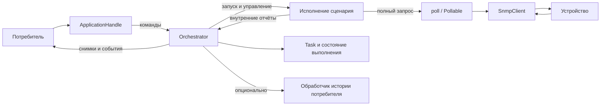

# Архитектура traffic-engineer-tools

Этот файл — основной справочник по назначению компонентов и их взаимодействию.
Он описывает текущее устройство кода, прежде всего монитора в `tools-core`.
При изменении ответственности или контракта компонента соответствующий раздел
нужно обновлять вместе с кодом. Планы разработки ведутся в [TODO.md](TODO.md).

Описание ниже сверено с текущим рабочим деревом. Материалы в `docs/` могут
описывать предыдущие версии архитектуры и не являются источником этого документа.

## Содержание

- [Назначение и границы проекта](#назначение-и-границы-проекта)
- [Карта компонентов монитора](#карта-компонентов-монитора)
- [Описание задачи и проверка конфигурации](#описание-задачи-и-проверка-конфигурации)
- [Сборка, запуск и завершение](#сборка-запуск-и-завершение)
- [Оркестратор и внутреннее состояние](#оркестратор-и-внутреннее-состояние)
- [Сценарии](#сценарии)
- [Запросы, попытки и SNMP](#запросы-попытки-и-snmp)
- [Расписание повторяющихся запросов](#расписание-повторяющихся-запросов)
- [Лимит, результаты и история задачи](#лимит-результаты-и-история-задачи)
- [События, снимки и подписки](#события-снимки-и-подписки)
- [Запись истории событий](#запись-истории-событий)
- [Ошибки и перезапуски](#ошибки-и-перезапуски)
- [Координация](#координация)
- [Как расширять библиотеку и этот документ](#как-расширять-библиотеку-и-этот-документ)
- [Открытые вопросы и проверки](#открытые-вопросы-и-проверки)

## Назначение и границы проекта

Основной продукт — переиспользуемая библиотека для транспортного инженера:
сетевой опрос и управление устройствами, расчёты и преобразования данных.
Потребитель библиотеки может иметь собственный интерфейс и способ хранения.

| Крейт | Назначение |
|---|---|
| [`tools-core`](crates/tools-core/src/lib.rs) | Доменные типы, монитор, SNMP, опрос, конвертеры и другие инструменты без UI |
| [`tctl`](crates/tools-cli/src/main.rs) | Текущая CLI-реализация: загрузка конфигурации, управление сеансом и отображение результатов |
| `net-monitor` | Отдельный замороженный сервис; развитие монитора `tools-core` от него не зависит |

Планируемое приложение на axum будет ещё одним потребителем ядра.
Ни CLI, ни будущий HTTP-интерфейс не определяют границы публичного API библиотеки.
Разбор внешнего формата и представление ошибок принадлежат интерфейсу;
правила корректности доменных значений принадлежат ядру.

## Карта компонентов монитора

Публичная точка входа — `tools_core::monitor`.
Она реэкспортирует конфигурации, управление, результаты, события и ошибки.
Внутренние модули `runtime`, `task` и `scenario` скрыты за этой границей.
Отдельные механизмы запросов и SNMP также доступны через `tools_core::polling`
и `tools_core::snmp`.

| Компонент | Ответственность | Исходник |
|---|---|---|
| `AppConfig` | Общие настройки: выход истории событий и политика перезапуска | [runtime/app.rs](crates/tools-core/src/monitor/runtime/app.rs) |
| `TaskConfig` | Проверенное описание одной задачи | [task/config.rs](crates/tools-core/src/monitor/task/config.rs) |
| `Application` | Подготовленный монитор до запуска | [runtime/app.rs](crates/tools-core/src/monitor/runtime/app.rs) |
| `RunningApplication` | Владение фоновым выполнением и его завершение | [runtime/app.rs](crates/tools-core/src/monitor/runtime/app.rs) |
| `ApplicationHandle` | Клонируемый доступ к командам, снимкам и подпискам | [runtime/app.rs](crates/tools-core/src/monitor/runtime/app.rs) |
| `Orchestrator` | Внутренний владелец состояния задач, их жизненного цикла и порядка событий | [runtime/orchestrator.rs](crates/tools-core/src/monitor/runtime/orchestrator.rs) |
| `Task` | Внутренняя конфигурация, ревизия, результаты, метрики и здоровье задачи | [task/task.rs](crates/tools-core/src/monitor/task/task.rs) |
| `ScenarioSpec` | Публичное описание выбранного сценария | [scenario/spec.rs](crates/tools-core/src/monitor/scenario/spec.rs) |
| Исполнение GET/SET | Подготовка запроса, расписание, команды и отчёты конкретного сценария | [snmp_get.rs](crates/tools-core/src/monitor/scenario/snmp_get.rs), [snmp_set.rs](crates/tools-core/src/monitor/scenario/snmp_set.rs) |
| `SnmpGetSpec`, `SnmpSetSpec` | Проверенные параметры SNMP-запросов без сетевого клиента | [snmp/request.rs](crates/tools-core/src/snmp/request.rs) |
| `poll`, `AttemptConfig`, `Pollable` | Общий механизм попыток одного полного запроса | [polling](crates/tools-core/src/polling/mod.rs) |
| `SnmpClient`, `Resolver` | Сетевые операции и подготовка OID с учётом профиля устройства | [client.rs](crates/tools-core/src/snmp/client.rs), [resolve.rs](crates/tools-core/src/snmp/resolve.rs) |
| `MonitorSnapshot`, `MonitorSubscription`, `MonitorEvent` | Наблюдение за состоянием и изменениями | [view.rs](crates/tools-core/src/monitor/task/view.rs), [subscription.rs](crates/tools-core/src/monitor/runtime/subscription.rs), [event.rs](crates/tools-core/src/monitor/event.rs) |

Упрощённая схема работающего монитора:



## Описание задачи и проверка конфигурации

Конфигурация состоит из нескольких уровней:

```text
TaskConfig
  name
  scenario: ScenarioSpec
    SnmpGetScenarioSpec / SnmpSetScenarioSpec
      request: SnmpGetSpec / SnmpSetSpec
      schedule: PollSchedule
      attempt: AttemptConfig
  limit
  deep_history
```

`TaskConfig` содержит свойства задачи: имя, сценарий, лимит полных выполнений
и глубину локальной истории. Конструктор отклоняет пустое имя.
Универсального интервала в `TaskConfig` нет: расписание принадлежит сценарию.

Конструкторы ядра проверяют конфигурацию по мере её сборки.
Например, `AttemptConfig::try_new` проверяет таймаут,
конструктор спецификации сценария — длительность расписания,
а разбор SNMP-запроса — адрес, community, профиль, OID и значения SET.
Вызов этих конструкторов из CLI или другого интерфейса не дублирует проверки.

Синтаксически корректный запрос ещё не означает, что устройство доступно
и поддерживает запрошенную операцию. Такие результаты появляются при исполнении.

## Сборка, запуск и завершение

`Application::new(config, tasks)` создаёт каналы и внутреннее состояние,
назначает идентификаторы начальным задачам и оставляет их в `Idle`.
Этот этап не обращается к сети, не запускает фоновые задачи и может выполняться
вне контекста Tokio. Пустой набор задач допустим.

До запуска доступны `id`, `task_ids`, `subscribe` и `subscribe_with_snapshot`.
Начальные события ещё не публикуются, поэтому можно заранее подключить наблюдателя.

`Application::spawn(self)` потребляет подготовленный монитор и запускает
оркестратор в текущем Tokio runtime. Оркестратор публикует добавление начальных
задач и инициирует их запуск. Возврат `RunningApplication` не означает,
что сетевые клиенты уже подготовлены. Готовность каждой задачи подтверждается
отдельно через `TaskStarted` и состояние `Active`.

`RunningApplication::handle()` возвращает клонируемый `ApplicationHandle`.
Копии handle управляют одним монитором; владение выполнением остаётся
у `RunningApplication`.

Пример порядка действий для получения начального снимка:

```rust
use tools_core::monitor::{
    AppConfig, Application, ApplicationError, MonitorSnapshot, TaskConfig,
};

pub async fn initial_snapshot(
    tasks: Vec<TaskConfig>,
) -> Result<MonitorSnapshot, ApplicationError> {
    let application = Application::new(AppConfig::default(), tasks);
    let _subscription = application.subscribe_with_snapshot();
    let running = application.spawn();
    let monitor = running.handle();

    let result = monitor.get_snapshot().await;
    running.shutdown().await?;
    Ok(result?)
}
```

В длительном сеансе потребитель читает подписку и вызывает команды до `shutdown`.
Пример выше показывает только сборку, получение снимка и завершение;
он не ожидает первого сетевого результата.

`RunningApplication::shutdown(self).await` запрашивает остановку и ждёт
оркестратор, завершение сценариев и таймеров, а также обработчик передачи истории.
Это не команда перевести само устройство в какое-либо безопасное состояние.

Удаление владельца без `shutdown`, в том числе при отмене future завершения,
запрашивает аварийную отмену оркестратора. Его `JoinSet` отменяют внутренние задачи.
`Drop` не может асинхронно дождаться их завершения или гарантировать доставку
накопленной истории. Для ожидаемого завершения предназначен `shutdown().await`.

## Оркестратор и внутреннее состояние

`Orchestrator` последовательно обрабатывает команды и отчёты сценариев.
Он владеет реестром задач, состояниями выполнения и счётчиком событий.
Через внутренний `OrchestratorHandle` публичный handle передаёт команды
и ожидает ответы по отдельным каналам.

`Task` хранит `TaskConfig`, ревизию, временные метки, последний результат,
локальную историю, метрики и здоровье. Текущий статус, поколение исполнения,
счётчик перезапусков и handle сценария находятся в записи оркестратора.
Потребитель видит копию этих данных в `TaskView`.

Основные команды `ApplicationHandle`:

| Команда | Поведение |
|---|---|
| `add_task` | Регистрирует задачу в `Idle`, возвращает `TaskId`; исполнения ещё нет |
| `start_task` | Начинает запуск из `Idle`, `Stopped` или `Completed` |
| `pause_task` | Передаёт паузу живому сценарию; при ожидании перезапуска переводит в паузу без запуска |
| `resume_task` | Возобновляет живой сценарий либо создаёт новый, если прежний уже завершился |
| `stop_task` | Запрашивает отмену сценария и переводит выполнявшуюся задачу в `Stopped` |
| `update_task` | Заменяет конфигурацию и увеличивает ревизию; поведение зависит от текущего статуса |
| `remove_task` | Удаляет задачу и отменяет её исполнение, если оно было запущено |

Ответ команды запуска подтверждает инициирование запуска, а не успешную
сетевую подготовку. Для живого сценария пауза и возобновление подтверждаются
его отчётами и соответствующими публичными событиями. Обычная пауза GET/SET
ожидает завершения текущего полного запроса с его повторами.

При изменении конфигурации активной задачи старое исполнение отменяется,
новое запускается с новым поколением. Метрики и накопленные результаты сохраняются.
У приостановленной задачи применение нового сценария откладывается до `resume`.
Явный новый `start_task` сбрасывает метрики и здоровье, сохраняя результаты и историю.

Временные метки имеют разные значения: `created_at` — создание задачи,
`config_updated_at` — изменение конфигурации, `updated_at` — последняя
учтённая активность задачи, включая результат выполнения или новый запуск.
Это не универсальная временная метка каждого изменения статуса.

## Сценарии

`ScenarioSpec` — описание поведения, которое можно клонировать, передавать
в `TaskConfig` и показывать в снимке. Он не содержит сетевого клиента
и не предоставляет публичный метод запуска.

Сейчас доступны два варианта: повторяющиеся `SnmpGet` и `SnmpSet`.
Это enum с реализациями внутри ядра; API подключения произвольной внешней
реализации сценария пока отсутствует.

Каждая реализация самостоятельно выполняет подготовку, следует своему расписанию,
обрабатывает команды и публикует отчёты. Оркестратор отвечает за жизненный цикл,
а не за вычисление следующего срока конкретного сценария.

Расположение кода в [scenario](crates/tools-core/src/monitor/scenario/mod.rs):

| Файл | Содержимое |
|---|---|
| `mod.rs` | Публичные реэкспорты и внутренняя точка запуска |
| `spec.rs` | Описания сценариев и их проверка |
| `execution.rs` | Результаты, статусы исходов, поколения и стадии паник |
| `error.rs` | Ошибки конфигурации, подготовки и исполнения |
| `runtime.rs` | Внутренние команды, отчёты, выбор реализации и общие вспомогательные функции |
| `snmp_get.rs`, `snmp_set.rs` | Самостоятельное исполнение GET и SET вместе с адаптерами запросов |
| `schedule.rs` | Публичный выбор расписания и внутренний таймер |
| `tests.rs` | Общие тесты сетевого исполнения; проверки без сокетов также находятся рядом с компонентами |

## Запросы, попытки и SNMP

`SnmpGetSpec` и `SnmpSetSpec` описывают сетевые параметры и элементы запроса.
Спецификации, `RawSnmpOidItem`, `RawSnmpSetItem` и `SnmpQueryError` принадлежат
`tools_core::snmp` и доступны независимо от монитора. `tools_core::monitor`
сохраняет реэкспорты этих типов. Расписание и параметры попыток принадлежат
описанию сценария и не входят в спецификацию SNMP-запроса.
GET принимает `SnmpGetItem`: OID, необязательное имя и пользовательский парсер.
SET принимает `SnmpSetItem`: OID, имя и уже типизированное значение.
Эти элементы доступны в `tools_core::snmp`.

Есть два способа сборки:

- Типизированный: `SnmpGetSpec::new` и `SnmpSetSpec::try_new` принимают
  `SocketAddr`, `Community`, необязательный профиль и элементы запроса.
- Строковый: `from_raw` разбирает входные строки и использует тот же путь сборки.
  Существующие сигнатуры удобны для адаптеров конфигурации.

Поля спецификаций закрыты; методы чтения возвращают значения, ссылки и
неизменяемые срезы. `Community` создаётся через `parse`, `TryFrom<String>`
или `FromStr` с действующим ограничением в 1–32 байта.
Конструктор SET проверяет значения существующим кодировщиком и возвращает
`SnmpQueryError::InvalidSetValue` с позицией элемента и исходной ошибкой.
Неподдерживаемые типы, включая текущий `TimeTicks`, отклоняются до запуска.

Произвольные числовые OID доступны без профиля. Профиль добавляет алиасы,
метаданные, кодирование значений и правила достройки OID.
`Resolver` выполняется при подготовке сценария: при необходимости получает SCN
и формирует окончательные OID. Пользовательские имя и парсер GET имеют приоритет
перед подстановкой из профиля. Для SET значения уже закодированы до резолюции.
При наличии отдельной community чтения SET использует её для подготовки OID.

`SnmpClient` выполняет сетевые операции. В сценариях его внутренние повторы
отключены: попытками полного запроса управляет общий `poll`, чтобы не складывать
независимые механизмы повторов.

[`poll`](crates/tools-core/src/polling/poll.rs) работает с адаптером `Pollable`
и его типизированным результатом. `AttemptConfig` задаёт таймаут одной попытки,
повторы после первой попытки и задержку между ними. После первого успеха
дальнейшие попытки не выполняются. Таймауты и временные ошибки допускают повтор,
фатальная ошибка завершает полный запрос сразу.

Итог полного запроса — `Response::Success` или `Response::NoResponse`.
Отсутствие ответа после исчерпания попыток является штатным результатом.
`AttemptConfig::budget()` оценивает время по таймаутам и паузам;
расписание не ограничивается условием `interval >= budget`.

## Расписание повторяющихся запросов

`PollSchedule` принадлежит спецификации повторяющегося сценария.
Внутренний `PollTimer` использует монотонный `Instant`.

| Режим | Правило |
|---|---|
| `FixedRate { period }` | Сроки принадлежат сетке `origin + n × period`; длительность запроса не сдвигает сетку |
| `FixedDelay { delay }` | Следующий срок отсчитывается от завершения полного запроса, включая его повторы |

Первый запрос ожидает полный период или задержку после подготовки сценария.
Запросы одного сценария выполняются последовательно. В `FixedRate` просроченные
старты пропускаются без серии догоняющих запросов; сетка при этом сохраняется.
Если запрос завершился точно на следующей границе сетки, этот срок ещё доступен.

После `resume` режим `FixedDelay` ждёт полную задержку, а `FixedRate` использует
ближайшую будущую точку исходной сетки. При возобновлении точно на границе
ожидается следующий период. Новый запуск сценария создаёт новую локальную сетку.

Обе длительности должны быть положительными. Локальная сетка отдельного
сценария не синхронизирует несколько устройств по общей эпохе.

В текущем YAML CLI длительность задаётся `interval`, а режим — необязательным
`schedule: fixed_rate` или `schedule: fixed_delay`. По умолчанию используется
`fixed_delay`. Это формат CLI, а не обязательный формат конфигурации библиотеки.

## Лимит, результаты и история задачи

`limit` считает полные выполнения сценария. Для текущих GET/SET один полный
запрос с любым количеством внутренних повторов расходует одну единицу.
Успех и `NoResponse` учитываются одинаково. `limit = 0` означает отсутствие лимита.

При достижении лимита публикуется `ExecutionFinished`, затем `TaskCompleted`,
и сценарий отменяется. Ошибки подготовки, фатальные ошибки исполнения и паники
сейчас не создают `ScenarioExecution` и счётчик не увеличивают.
Учёт фатальных ошибок остаётся открытым вопросом.

`ScenarioExecution` содержит время завершения, длительность и `ScenarioOutcome`.
`OutcomeStatus` отделяет оценку результата от статуса самой задачи.
Текущие GET/SET сопоставляют `Success` со `Succeeded`, а `NoResponse` с `Failed`.
Вариант `Degraded` присутствует в контракте, но этими исходами сейчас не формируется.

`ExecutionMetrics` считает полные выполнения и исходы, хранит последнюю,
минимальную и максимальную длительности. `Health` отражает последние выполнения,
последовательные неудачные результаты и диагностическую ошибку сценария.

Последний результат хранится отдельно от истории. `deep_history` задаёт число
предыдущих результатов в локальном кольце задачи; при нуле последний результат
остаётся доступным. Эта история результатов отличается от выхода событий
`history_sink`.

## События, снимки и подписки

`MonitorSnapshot` — снимок состояния всех задач. Он содержит `application_id`,
`next_seq` и список `TaskView`, упорядоченный по идентификаторам.
Изменение полученного `TaskView` не меняет задачу в мониторе.

`MonitorEvent` содержит метаданные `EventMeta` и данные `EventData`.
События сообщают об изменениях жизненного цикла, результатах, ошибках и паниках.
Некоторые события, например `TaskAdded`, не содержат всей конфигурации задачи:
полное состояние при необходимости читается из снимка.

Идентификаторы решают разные задачи:

| Поле | Значение |
|---|---|
| `application_id` | Типизированный `ApplicationId`; определяет экземпляр монитора |
| `task_id` | Идентификатор задачи внутри этого монитора |
| `revision` | Версия конфигурации; начинается с 1 и увеличивается при обновлении |
| `generation` | Поколение исполнения; меняется при новом запуске сценария, включая перезапуск |
| `seq` | Общий порядок событий одного монитора, а не отдельной задачи |

`ApplicationId` поддерживает сравнение, хеширование, отладочный и строковый вывод.
Для идентификации задачи среди нескольких экземпляров монитора используется
пара `(ApplicationId, TaskId)`.

Оркестратор отбрасывает отчёты, не принадлежащие текущему исполнению задачи.
Это не позволяет позднему отчёту отменённого сценария изменить новое состояние.

`subscribe()` возвращает поток будущих событий через `broadcast`.
Медленный получатель может получить `Lagged`; библиотека не обещает
бесконечного хранения событий для каждой подписки.

`subscribe_with_snapshot()` возвращает `MonitorSubscription` из снимка и
связанного потока событий. До запуска `Application` делает это синхронно;
после запуска `ApplicationHandle` выполняет операцию через оркестратор.
Во втором случае снимок и подписка создаются внутри одной обработки команды.
`next_seq` указывает номер следующего события после снимка.

Для восстановления после `Lagged` потребитель получает новый согласованный
снимок и подписку. Отдельные вызовы `get_snapshot()` и `subscribe()`
не предоставляют такой общей границы и могут пропустить изменение между ними.

## Запись истории событий

`AppConfig.history_sink` — необязательный `mpsc::Sender<MonitorEvent>`.
Потребитель создаёт внешний канал и организует чтение: запись в файл, БД
или другую обработку. Указывать его для обычной подписки необязательно.

CLI принимает путь к файлу истории в корне YAML-конфигурации:

```yaml
history_sink: history.jsonl
tasks: []
```

Относительный путь считается от каталога YAML-файла; абсолютный используется
напрямую. Отсутствующее поле или `null` отключают историю. Каталог назначения
должен существовать. Полный пример: [poll.yaml](crates/tools-cli/examples/poll.yaml).
Команда запуска сохраняется: `tctl poll --config path/to/poll.yaml`.

CLI открывает файл до запуска монитора и дописывает в него JSONL: один
сериализованный `MonitorEvent` на строку. Отдельного типа записи нет.
Типы событий и вложенных результатов поддерживают `Serialize` и `Deserialize`.
UUID и OID представлены строками, длительности — объектами `secs`/`nanos`,
значения enum используют стандартное представление Serde с именами вариантов.
При чтении OID проверяется штатным парсером. Например:

```json
{"metadata":{"seq":0,"at":"2026-11-07T00:00:00Z","application_id":"f47ac10b-58cc-4372-a567-0e02b2c3d479","task_id":1,"generation":0,"revision":1},"data":"TaskAdded"}
```

События `TaskAdded` и `TaskSpecUpdated` по-прежнему не содержат конфигурации
задачи; файл сохраняет именно поток событий. Формат напрямую отражает типы core.
Разные запуски в одном файле различаются по `application_id`.

Отдельная задача CLI читает ограниченный канал и сбрасывает буфер после каждого
события. Ошибка записи или сбой writer завершает монитор и возвращается из CLI.
По Ctrl+C CLI останавливает монитор при работающем writer, затем дожидается
записи оставшихся событий и финального `flush`.

Оркестратор передаёт события во внутреннюю ограниченную очередь, а отдельная
задача пересылает их во внешний канал. Заполнение очередей создаёт обратное
давление и может задержать обработку команд и отчётов оркестратором.

При штатной остановке внутренняя очередь закрывается, а обработчик истории
ожидается до завершения пересылки или обнаружения отключённого получателя.
Если живой получатель не читает заполненный внешний канал, завершение может ждать
его неограниченно долго. При отключении получателя обработчик пишет предупреждение
и прекращает передачу; гарантии записи или повторной доставки сейчас нет.

Передача в канал не подтверждает сохранение на диск или в БД.
Текущая реализация не является долговечным журналом и не гарантирует
сохранность после аварийной отмены или сбоя процесса.

## Ошибки и перезапуски

Ошибки принадлежат своим модулям; корневой `tools_core::Error` агрегирует их.

| Тип | Когда используется |
|---|---|
| `TaskError`, `ScenarioSpecError`, `SnmpQueryError`, `polling::ConfigError` | Проверка и сборка конфигурации |
| `ScenarioBuildError` | Подготовка исполнения, включая клиента и резолюцию OID |
| `ScenarioExecutionError` | Фатальная ошибка полного запроса |
| `MonitorCommandError` | Ошибка команды: неизвестная задача или закрытый канал |
| `ApplicationError` | Завершение приложения и ошибка фонового оркестратора |

`ApplicationError::Command` оборачивает ошибку команды завершения,
а `ApplicationError::Runtime` сообщает об ошибке фонового выполнения.
Корневой `tools_core::Error::MonitorCommand` агрегирует `MonitorCommandError`.

Неуспешный сетевой результат `NoResponse` не требует пересоздания сценария.
Ошибка подготовки, фатальная ошибка исполнения или перехваченная паника
приводят к `Restarting` и планированию нового запуска.
`PanicStage` различает подготовку, выполнение запроса и остальную логику сценария.

Текущий `RestartPolicy::default()` увеличивает задержку от 1 до 60 секунд.
При успешной подготовке счётчик попыток перезапуска сбрасывается.
Параметры внутри политики пока закрыты и отдельного конструктора для их изменения нет.
Этот механизм отличается от повторов отдельного сетевого запроса в `AttemptConfig`.

## Координация

[coordination.rs](crates/tools-core/src/monitor/coordination.rs) содержит
расчётные типы: `Phase`, `Cycle`, `Epoch`, `PhaseState` и связанные ошибки.
Они позволяют определить положение в цикле относительно выбранной эпохи.
Это ещё не работающий вариант `ScenarioSpec` для управления устройством.

Планируемый сценарий координации должен рассчитывать требуемую фазу
по общей шкале времени и отправлять управляющие команды, включая keepalive.
Опоздание сокращает остаток текущей фазы и не сдвигает общую сетку;
пропущенные фазы не догоняются. Его расписание будет принадлежать самому сценарию.

## Как расширять библиотеку и этот документ

Для нового сценария нужны описание и его проверки, внутренняя реализация,
вариант `ScenarioSpec` и выбор исполнения во внутреннем runtime.
При новом виде результата нужно дополнить контракт исходов и соответствующие
представления потребителей. Оркестратор должен сохранять общую ответственность
за жизненный цикл и порядок событий.

Для новой сетевой операции сначала определяется адаптер запроса и применение
общего механизма `poll`. Его можно использовать независимо от монитора.
Проверка оборудования по сети остаётся этапом исполнения, а не разбора конфига.

При пополнении документа для компонента достаточно указать:

1. Назначение и причину его существования.
2. Ответственность, входные данные и результат.
3. Связи с соседними компонентами и владение состоянием.
4. Публичный контракт либо внутреннюю область использования.
5. Важные гарантии, ограничения и ссылку на исходник.

Существующие разделы нужно исправлять при изменении поведения.
Завершённые изменения не следует оставлять в виде противоречащих друг другу
описаний «до» и «после». Новые намерения сначала помечаются как планы.
Когда раздел разрастается, подробности можно вынести в отдельный документ,
сохранив здесь назначение компонента и ссылку.

## Открытые вопросы и проверки

Актуальные задачи находятся в [TODO.md](TODO.md). В частности, остаются решения
о подсчёте фатальных ошибок и о поведении выхода истории при медленном получателе.
Отдельный контракт подключения внешних сценариев пока не реализован.

Глубина кольца результатов сейчас устанавливается при создании `Task`.
Обновление `deep_history` через `update_task` само по себе не пересоздаёт кольцо;
применение такой настройки к уже зарегистрированной задаче требует уточнения.

Основные проверки: `make check`, тесты `tools-core`, тесты `tctl` и Clippy.
Из-за настройки кросс-компиляции команды Cargo для локальной проверки используют
`--target x86_64-unknown-linux-gnu`.
Сетевые тесты сценариев используют UDP; пока действует отдельное указание
их не запускать. Такие тесты собираются через `--no-run`, а проверки
без сокетов и с виртуальным временем запускаются отдельно.
