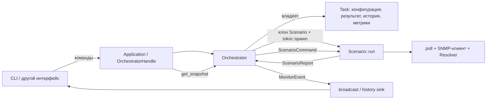

# Архитектура traffic-engineer-tools

Актуально на 6 ноября 2026 года. Документ описывает реализованную архитектуру
после перехода монитора на самостоятельные сценарии `Scenario`.

## Workspace

| Крейт | Назначение |
|---|---|
| `tools-core` | Основной продукт: переиспользуемая библиотека без UI. Монитор, SNMP, расчёты координации, SCN, фазы и парсеры логов. |
| `tctl` (`crates/tools-cli`) | CLI: загрузка задач из YAML, монитор реального времени, конвертеры SCN. |
| `net-monitor` | Независимый сервис тестирования устройств. Заморожен, в этом рефакторинге не изменялся. |

Сетевые клиенты и расчётные функции core можно использовать независимо от монитора.
В мониторе сейчас реализованы периодические SNMP GET и SET. В
`monitor::coordination` есть расчётные типы цикла, фаз и эпохи; отдельного
координационного сценария пока нет.

## Поток управления



`Application` — тонкий фасад над `OrchestratorHandle`. Он запускает оркестратор
и перенаправляет команды. Загрузкой YAML и отображением занимается CLI.

`Orchestrator` владеет задачами и текущими исполнениями. Его цикл принимает
команды интерфейса и отчёты сценариев. Он управляет запуском, остановкой,
перезапусками, статусами, историей, метриками и публикацией событий.
`ScenarioHandle` хранит поколение, `AbortHandle` и отправитель команд.

## Самостоятельный Scenario

[scenario.rs](../crates/tools-core/src/monitor/scenario.rs) содержит enum `Scenario`,
весь поток исполнения GET/SET, их спеки, протокол взаимодействия с оркестратором
и небольшие сетевые адаптеры. Тесты находятся в
[scenario/tests.rs](../crates/tools-core/src/monitor/scenario/tests.rs).

Варианты `Scenario::SnmpGet(SnmpGetScenarioSpec)` и
`Scenario::SnmpSet(SnmpSetScenarioSpec)` содержат конфигурацию. Клиенты, разрешённые
OID и прочее рабочее состояние создаются внутри `run()`.

`Scenario::run()` живёт от запуска до остановки или ошибки. В текущих GET/SET
один `ProbeExecution` соответствует одному запросу со всеми его попытками.
Это единица учёта результатов, истории, метрик и лимита исполнений.

Каждая ветка `Scenario::run()` самостоятельно выполняет:

1. Создание клиентов и подготовку запроса через `Resolver`, включая получение
   SCN, когда его требует профиль и OID.
2. Ожидание запуска и выполнение сетевой операции.
3. Обработку паузы и возобновления.
4. Измерение длительности и отправку результата, ошибки или сообщения о панике.

Весь порядок действий виден в одной ветке enum. Похожие участки GET и SET
пока оставлены рядом. Новые сценарии могут иметь собственную последовательность
операций и правила ожидания; общего цикла исполнителя вокруг них нет.

### Текущие SNMP-сценарии

Первый запрос выполняется после `interval`. Следующий дедлайн вычисляется
после завершения текущего запроса как `Instant::now() + interval`.
Повторный `Resume` в активном состоянии дедлайн не сдвигает.

GET читает OID и формирует `SnmpGetSample` с сырым значением и, при наличии
парсера профиля, доменным представлением. SET отправляет подготовленные значения.
Для получения SCN в SET может использоваться отдельная community чтения;
команды отправляются с community записи.

Подготовка ограничена отдельным таймаутом. Паники подготовки, сетевого исполнения
и остальной части `run()` перехватываются и передаются оркестратору.

### Сетевые попытки

[poll()](../crates/tools-core/src/polling/poll.rs) управляет таймаутом одной
попытки, повторами, задержками и сбором сведений о попытках.
`Pollable::poll()` выполняет одну попытку. Текущие GET/SET используют приватные
адаптеры `SnmpGetRequest` и `SnmpSetRequest` из `scenario.rs`.

Успех прекращает повторы. Временные ошибки и таймауты допускают следующую
попытку; фатальная ошибка завершает операцию. Исчерпание попыток возвращает
`Response::NoResponse` как штатный результат. Подробности сетевых попыток
остаются в `Response<T>`.

Параметры `interval` и `AttemptConfig` принадлежат конкретной SNMP-спеке.
Её конструктор проверяет положительный интервал и
`interval >= attempt.budget()`. Лимит исполнений относится к задаче.

## Конфигурация и владение

[TaskConfig](../crates/tools-core/src/monitor/task/spec.rs) содержит:

- `name` — имя задачи;
- `scenario` — сохранённый `Scenario`;
- `limit` — лимит завершённых исполнений, `0` означает отсутствие лимита;
- `deep_history` — глубину истории предыдущих результатов.

Конструктор: `TaskConfig::try_new(name, scenario, limit, deep_history)`.
`TaskSpec` оборачивает конфигурацию и добавляет `SpecRevision` и время обновления.
`Task` хранит эту спеку, последний результат, историю, метрики и здоровье.

Единственный источник конфигурации — `Task` в оркестраторе. При каждом запуске
`spawn_scenario()` клонирует актуальный сохранённый `Scenario` и перемещает клон
в новую Tokio-задачу. Отдельная изменяемая копия спеки в runtime не хранится.

Полученный SCN, достроенные OID и клиенты принадлежат одному исполнению.
При пересоздании подготовка выполняется заново из сохранённой конфигурации.
`Arc` для передачи спеки не используется.

`SpecRevision` обозначает версию конфигурации. `Generation` обозначает конкретный
запуск; перезапуск с той же конфигурацией получает новое поколение.

## Жизненный цикл

| Действие | Поведение |
|---|---|
| Добавление | Создаётся задача в `Idle`, публикуется `TaskAdded`. |
| Запуск | Сбрасываются метрики запуска и здоровье, создаётся новое поколение, публикуется `TaskStarting`. |
| Успешная подготовка | Сценарий отправляет `Built`; оркестратор переводит задачу в `Active` и публикует `TaskStarted`. |
| Пауза живого исполнения | Команда передаётся сценарию. Текущий запрос со всеми попытками завершается; затем подтверждается `Paused`. |
| Возобновление живого исполнения | Сценарий подтверждает `Resumed` и начинает новый интервал ожидания. |
| Остановка | Оркестратор вызывает `abort()`, удаляет handle и публикует `TaskStopped`. |
| Удаление | Исполнение прерывается, задача удаляется, публикуется `TaskRemoved`. |
| Достижение лимита | Сохраняется последний результат, исполнение прерывается, последовательно публикуются `ProbeExecuted` и `TaskCompleted`. |

Новый ручной запуск сбрасывает метрики и здоровье, сохраняя последний результат
и историю. Автоматические перезапуски и обновления спеки сохраняют метрики запуска.
История содержит предыдущие результаты; текущий результат хранится отдельно.

### Обновление спеки

Оркестратор сохраняет новый `TaskConfig`, увеличивает ревизию и публикует
`TaskSpecUpdated`.

- В `Starting`, `Active` и `Restarting` прежнее исполнение прерывается и сразу
  запускается новое поколение с `TaskStarting { attempt: 0 }`.
- В `Paused` прежнее исполнение прерывается, задача остаётся на паузе.
  Последующий `Resume` создаёт новое поколение из обновлённой спеки.
- В `Idle`, `Stopped` и `Completed` новая конфигурация сохраняется до запуска.

Счётчик попыток рестарта сбрасывается при обновлении спеки и возобновлении
без живого исполнителя.

### Ошибки и перезапуск

Ошибка подготовки, фатальная ошибка исполнения или паника завершают текущее
исполнение. Оркестратор записывает ошибку, переводит задачу в `Restarting`
и планирует перезапуск через `RestartPolicy`: экспоненциальная задержка
от 1 до 60 секунд. Ограничения количества рестартов сейчас нет.

Отчёты принимаются только от текущего handle с соответствующим
`Generation`. Команда отложенного `Respawn` тоже содержит поколение. Старый
отчёт или таймер не может повлиять на более новое исполнение.
Во время паузы или после остановки таймер не запускает сценарий.

## Результаты, события и snapshot

Внутренний протокол исполнения — `ScenarioCommand::{Pause, Resume}` и
`ScenarioReport`. Оркестратор преобразует отчёты в публичный контракт
[monitor/event.rs](../crates/tools-core/src/monitor/event.rs):
`MonitorEvent { metadata: EventMeta, data: EventData }`.

Метаданные включают `seq`, `at`, `source`, `task_id`, `generation` и `revision`.
События публикуются в `broadcast`; при настроенном history sink также передаются
через очередь отдельному `log_writer`.

Публичные события сохранены: `TaskAdded`, `TaskStarting`, `TaskStarted`,
`BuildFailed`, `ProbeExecuted`, `ProbeError`, `WorkerPanicked`, `TaskPaused`,
`TaskResumed`, `TaskStopped`, `TaskRemoved`, `TaskSpecUpdated`, `TaskCompleted`.
Имя `WorkerPanicked` остаётся частью внешнего контракта.

События исполнения, последний результат и история используют общий
`ProbeExecution { finished_at, elapsed, outcome }`:

- `finished_at` — время завершения;
- `elapsed` — длительность одного рабочего шага, включая все попытки и задержки
  между ними; подготовка клиентов и ожидание `interval` находятся вне этого измерения;
- `outcome` — `ProbeOutcome::SnmpGet(Response<Vec<SnmpGetSample>>)` или
  `ProbeOutcome::SnmpSet(Response<()>)`.

`OutcomeStatus::{Succeeded, Degraded, Failed}` определяет оценку результата.
Текущие SNMP-сценарии используют успех и неуспех. `NoResponse` публикуется как
`ProbeExecuted` с неуспешным исходом и само по себе не вызывает перезапуск.
`ProbeError` обозначает ошибку исполнения, а не штатное отсутствие ответа.

`ExecutionMetrics` учитывает завершённые исполнения, их статусы и длительность.
`Health` хранит время последнего исполнения, число последовательных неуспешных
исходов и последнюю ошибку подготовки или исполнения.

`get_snapshot()` возвращает `MonitorSnapshot` со списком `TaskView`, отсортированным
по `TaskId`. В view входят актуальный `Scenario`, отдельный `limit`, статус,
результат, история, метрики и здоровье. CLI отображает snapshot и события;
формат YAML при переходе на `Scenario` сохранён.

## Карта кода

| Модуль | Что находится внутри |
|---|---|
| [monitor/scenario.rs](../crates/tools-core/src/monitor/scenario.rs) | Enum сценариев, полное исполнение GET/SET, спеки, команды, отчёты, поколения, сетевые адаптеры. |
| [monitor/runtime/orchestrator.rs](../crates/tools-core/src/monitor/runtime/orchestrator.rs) | Владение задачами, управление исполнениями, рестарты, обновление состояния и события. |
| [monitor/runtime/app.rs](../crates/tools-core/src/monitor/runtime/app.rs) | Фасад `Application`. |
| [monitor/task](../crates/tools-core/src/monitor/task) | Конфигурация, ревизии, состояние, история, здоровье, метрики и snapshot. |
| [monitor/probe](../crates/tools-core/src/monitor/probe) | Используемые типы запросов, результатов и ошибок. |
| [polling](../crates/tools-core/src/polling) | Общий механизм сетевых попыток. |
| [snmp](../crates/tools-core/src/snmp) | Клиент, профили, OID, SCN-резолюция, кодирование значений и парсеры. |
| [commands/poll](../crates/tools-cli/src/commands/poll) | YAML-конфигурация, обработка событий и отображение CLI. |

Старые `runtime/worker.rs`, `ProbeSpec`, `Probe`, `SnmpGetProbe`, `SnmpSetProbe`
и прежние методы сборки удалены. Переходник `ProbeSpec -> Scenario` удалён.
Сценарии исполняются напрямую из сохранённого `TaskConfig`.

## Проверки

На последнем этапе выполнены:

```sh
make check
make clippy
cargo test --target x86_64-unknown-linux-gnu -p tools-core -p tctl --no-run
```

Компиляция и Clippy проходят; в проекте остаются предупреждения линтера.
Тесты core и CLI собраны. На последнем этапе тесты, включая UDP, не запускались
по текущей договорённости.

В `.cargo/config.toml` задан Windows-target по умолчанию. Для локальной проверки
на Linux используется явный `--target x86_64-unknown-linux-gnu`, как в командах выше.
