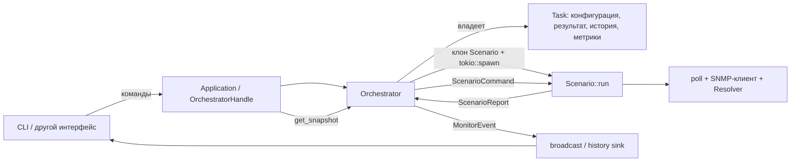

# Архитектура traffic-engineer-tools

Актуально на 6 ноября 2026 года. Документ описывает реализованную архитектуру
после перехода монитора на самостоятельные сценарии `Scenario`.

## Workspace

| Крейт | Назначение |
|---|---|
| `tools-core` | Основной продукт: переиспользуемая библиотека без UI. Монитор, SNMP, расчёты координации, SCN, фазы и парсеры логов. |
| `tctl` (`crates/tools-cli`) | CLI: загрузка задач из YAML, монитор реального времени, конвертеры SCN. |
| `net-monitor` | Независимый сервис тестирования устройств. Заморожен, в этом рефакторинге не изменялся. |

Сетевые клиенты и расчётные функции core можно использовать независимо от монитора.
В мониторе сейчас реализованы периодические SNMP GET и SET. В
`monitor::coordination` есть расчётные типы цикла, фаз и эпохи; отдельного
координационного сценария пока нет.

## Поток управления



`Application` — тонкий фасад над `OrchestratorHandle`. Он запускает оркестратор
и перенаправляет команды. Загрузкой YAML и отображением занимается CLI.

`Orchestrator` владеет задачами и текущими исполнениями. Его цикл принимает
команды интерфейса и отчёты сценариев. Он управляет запуском, остановкой,
перезапусками, статусами, историей, метриками и публикацией событий.
`ScenarioHandle` хранит поколение, `AbortHandle` и отправитель команд.

## Самостоятельный Scenario

[scenario.rs](../crates/tools-core/src/monitor/scenario.rs) содержит enum `Scenario`,
весь поток исполнения GET/SET, их спеки, протокол взаимодействия с оркестратором
и небольшие сетевые адаптеры. Тесты находятся в конце этого же файла,
во встроенном модуле `#[cfg(test)] mod tests`.

Варианты `Scenario::SnmpGet(SnmpGetScenarioSpec)` и
`Scenario::SnmpSet(SnmpSetScenarioSpec)` содержат конфигурацию. Клиенты, разрешённые
OID и прочее рабочее состояние создаются внутри `run()`.

`Scenario::run()` живёт от запуска до остановки или ошибки. В текущих GET/SET
один `ScenarioExecution` соответствует одному запросу со всеми его попытками.
Это единица учёта результатов, истории, метрик и лимита исполнений.

Каждая ветка `Scenario::run()` самостоятельно выполняет:

1. Создание клиентов и подготовку запроса через `Resolver`, включая получение
   SCN, когда его требует профиль и OID.
2. Ожидание запуска и выполнение сетевой операции.
3. Обработку паузы и возобновления.
4. Измерение длительности и отправку результата, ошибки или сообщения о панике.

Весь порядок действий виден в одной ветке enum. Похожие участки GET и SET
пока оставлены рядом. Новые сценарии могут иметь собственную последовательность
операций и правила ожидания; общего цикла исполнителя вокруг них нет.

### Текущие SNMP-сценарии

Первый запрос выполняется после `interval`. Следующий дедлайн вычисляется
после завершения текущего запроса как `Instant::now() + interval`.
Повторный `Resume` в активном состоянии дедлайн не сдвигает.

GET читает OID и формирует `SnmpGetSample` с сырым значением и, при наличии
парсера профиля, доменным представлением. SET отправляет подготовленные значения.
Для получения SCN в SET может использоваться отдельная community чтения;
команды отправляются с community записи.

Подготовка ограничена отдельным таймаутом. Паники подготовки, сетевого исполнения
и остальной части `run()` перехватываются и передаются оркестратору.

### Сетевые попытки

[poll()](../crates/tools-core/src/polling/poll.rs) управляет таймаутом одной
попытки, повторами, задержками и сбором сведений о попытках.
`Pollable::poll()` выполняет одну попытку. Текущие GET/SET используют приватные
адаптеры `SnmpGetRequest` и `SnmpSetRequest` из `scenario.rs`.

Успех прекращает повторы. Временные ошибки и таймауты допускают следующую
попытку; фатальная ошибка завершает операцию. Исчерпание попыток возвращает
`Response::NoResponse` как штатный результат. Подробности сетевых попыток
остаются в `Response<T>`.

Параметры `interval` и `AttemptConfig` принадлежат конкретной SNMP-спеке.
Её конструктор проверяет положительный интервал и
`interval >= attempt.budget()`. Лимит исполнений относится к задаче.

## Конфигурация и владение

[TaskConfig](../crates/tools-core/src/monitor/task/spec.rs) содержит:

- `name` — имя задачи;
- `scenario` — сохранённый `Scenario`;
- `limit` — лимит завершённых исполнений, `0` означает отсутствие лимита;
- `deep_history` — глубину истории предыдущих результатов.

Конструктор: `TaskConfig::try_new(name, scenario, limit, deep_history)`.
`TaskSpec` оборачивает конфигурацию и добавляет `SpecRevision` и время обновления.
`Task` хранит эту спеку, последний результат, историю, метрики и здоровье.

Единственный источник конфигурации — `Task` в оркестраторе. При каждом запуске
`spawn_scenario()` клонирует актуальный сохранённый `Scenario` и перемещает клон
в новую Tokio-задачу. Отдельная изменяемая копия спеки в runtime не хранится.

Полученный SCN, достроенные OID и клиенты принадлежат одному исполнению.
При пересоздании подготовка выполняется заново из сохранённой конфигурации.
`Arc` для передачи спеки не используется.

`SpecRevision` обозначает версию конфигурации. `Generation` обозначает конкретный
запуск; перезапуск с той же конфигурацией получает новое поколение.

## Жизненный цикл

| Действие | Поведение |
|---|---|
| Добавление | Создаётся задача в `Idle`, публикуется `TaskAdded`. |
| Запуск | Сбрасываются метрики запуска и здоровье, создаётся новое поколение, публикуется `TaskStarting`. |
| Успешная подготовка | Сценарий отправляет `Built`; оркестратор переводит задачу в `Active` и публикует `TaskStarted`. |
| Пауза живого исполнения | Команда передаётся сценарию. Текущий запрос со всеми попытками завершается; затем подтверждается `Paused`. |
| Возобновление живого исполнения | Сценарий подтверждает `Resumed` и начинает новый интервал ожидания. |
| Остановка | Оркестратор вызывает `abort()`, удаляет handle и публикует `TaskStopped`. |
| Удаление | Исполнение прерывается, задача удаляется, публикуется `TaskRemoved`. |
| Достижение лимита | Сохраняется последний результат, исполнение прерывается, последовательно публикуются `ExecutionFinished` и `TaskCompleted`. |

Новый ручной запуск сбрасывает метрики и здоровье, сохраняя последний результат
и историю. Автоматические перезапуски и обновления спеки сохраняют метрики запуска.
История содержит предыдущие результаты; текущий результат хранится отдельно.

### Обновление спеки

Оркестратор сохраняет новый `TaskConfig`, увеличивает ревизию и публикует
`TaskSpecUpdated`.

- В `Starting`, `Active` и `Restarting` прежнее исполнение прерывается и сразу
  запускается новое поколение с `TaskStarting { attempt: 0 }`.
- В `Paused` прежнее исполнение прерывается, задача остаётся на паузе.
  Последующий `Resume` создаёт новое поколение из обновлённой спеки.
- В `Idle`, `Stopped` и `Completed` новая конфигурация сохраняется до запуска.

Счётчик попыток рестарта сбрасывается при обновлении спеки и возобновлении
без живого исполнителя.

### Ошибки и перезапуск

Ошибка подготовки, фатальная ошибка исполнения или паника завершают текущее
исполнение. Оркестратор записывает ошибку, переводит задачу в `Restarting`
и планирует перезапуск через `RestartPolicy`: экспоненциальная задержка
от 1 до 60 секунд. Ограничения количества рестартов сейчас нет.

Отчёты принимаются только от текущего handle с соответствующим
`Generation`. Команда отложенного `Respawn` тоже содержит поколение. Старый
отчёт или таймер не может повлиять на более новое исполнение.
Во время паузы или после остановки таймер не запускает сценарий.

## Результаты, события и snapshot

Внутренний протокол исполнения — `ScenarioCommand::{Pause, Resume}` и
`ScenarioReport`. Оркестратор преобразует отчёты в публичный контракт
[monitor/event.rs](../crates/tools-core/src/monitor/event.rs):
`MonitorEvent { metadata: EventMeta, data: EventData }`.

События публикуются в `broadcast`; при настроенном history sink также передаются
через очередь отдельному `log_writer`.

### Метаданные событий

| Поле `EventMeta` | Семантика |
|---|---|
| `seq: u64` | Последовательность всех событий одного оркестратора, общая для всех его задач. Начинается с `0`, увеличивается на единицу для каждого сформированного события. |
| `at: DateTime<Utc>` | Время формирования события оркестратором. Может отличаться от времени завершения исполнения из-за обработки очереди отчётов. |
| `source: String` | Идентификатор экземпляра монитора, общий для всех его событий. `Application` передаёт свой UUID; при прямом создании `Orchestrator` источник задаёт вызывающий код. |
| `task_id: TaskId` | Идентификатор задачи внутри экземпляра монитора. Сохраняется при обновлениях конфигурации, остановках и повторных запусках. |
| `generation: Generation` | Текущее или последнее запущенное поколение исполнителя задачи. Каждый `spawn_scenario()` получает новое поколение. До первого запуска хранится начальное значение `Generation::first()`. |
| `revision: SpecRevision` | Актуальная ревизия сохранённой конфигурации задачи на момент формирования события. Начинается с `1`, увеличивается при каждом принятом обновлении `TaskConfig`. |

Порядок событий определяется `seq`; время `at` не обязано монотонно возрастать.
Для объединения потоков вызывающий код должен обеспечить уникальность `source`
между экземплярами монитора. При этом `(source, seq)` идентифицирует событие,
`(source, task_id)` — задачу, `(source, task_id, generation)` — запуск исполнителя.

`generation` сохраняет тип `Generation`. Его значение само по себе не доказывает,
что задача уже запускалась или что исполнитель сейчас существует: до первого
запуска используется то же начальное значение, которое получит первый исполнитель.
Остановка, завершение и ошибка сохраняют последнее поколение.

`generation` и `revision` независимы. Автоматический перезапуск увеличивает
поколение при прежней ревизии. `TaskSpecUpdated` содержит новую ревизию и прежнее
поколение; последующий `TaskStarting` получает новое поколение. Эта пара полей
в `TaskSpecUpdated` не описывает конфигурацию прежнего исполнителя.

### События и их полезная нагрузка

| Событие | Значение |
|---|---|
| `TaskAdded` | Задача сохранена в состоянии `Idle`. |
| `TaskSpecUpdated` | Новая конфигурация сохранена, ревизия увеличена. |
| `TaskStarting { attempt }` | Запущен новый исполнитель; подготовка ещё не завершена. |
| `TaskStarted` | Подготовка завершена, задача перешла в `Active`. Первого результата ещё может не быть. |
| `TaskPaused` | Задача перешла в `Paused`. Для живого исполнителя событие публикуется после подтверждения паузы; текущая операция перед этим завершается. Во время ожидания перезапуска пауза применяется оркестратором сразу. |
| `TaskResumed` | Существующий исполнитель подтвердил продолжение работы. Если при возобновлении нужен новый исполнитель, публикуются `TaskStarting` и затем `TaskStarted` при успешной подготовке. |
| `TaskStopped` | Оркестратор перевёл задачу в `Stopped`, запросил отмену исполнителя через `abort()` и перестал принимать его отчёты. Событие не подтверждает завершение всех сетевых действий на устройстве. |
| `TaskCompleted` | Достигнут лимит завершённых исполнений. Перед этим событием публикуется последний `ExecutionFinished`. |
| `TaskRemoved` | Задача удалена; её исполнитель отменяется, отчёты больше не принимаются. Предварительный `TaskStopped` не публикуется. |
| `ExecutionFinished { execution, metrics }` | Одно исполнение сформировало результат, включая штатный неуспех. `metrics` уже учитывает это исполнение. |
| `BuildFailed { error, retry_in }` | Подготовка завершилась `ScenarioBuildError`; таймаут подготовки представлен вариантом `Timeout`. Исполнитель завершает работу. |
| `ExecutionFailed { error, retry_in }` | Исполнение прервано `ScenarioExecutionError`; текущий исполнитель завершает работу. |
| `ScenarioPanicked { stage, reason, retry_in }` | Перехвачена паника. `PanicStage::{Build, Execution, Runtime}` различает подготовку, исполнение и управляющую часть сценария. `reason` содержит исходный текст причины без префикса этапа. |

`TaskStarting::attempt` — номер повторного запуска после сбоев. `0` используется
при первоначальном или ручном запуске, обновлении спеки и возобновлении без живого
исполнителя. После сбоя следующий автоматический запуск получает `1`, дальнейшие
неудачи подготовки увеличивают счётчик. Успешная подготовка сбрасывает счётчик.
Это отдельный счётчик от сетевых попыток внутри `poll()`.

`retry_in: Some(delay)` сообщает запланированную задержку перезапуска на момент
события. Последующая команда может отменить этот перезапуск. `None` означает,
что для этого сбоя автоматический перезапуск не запланирован. Текущая политика
для всех трёх событий сбоя всегда планирует перезапуск.

`TaskAdded` и `TaskSpecUpdated` — компактные факты; конфигурация и актуальное
состояние доступны через snapshot. Публикуемые события не содержат `TaskView`.
Повторная команда без перехода состояния может не породить событие. Ответ команды
паузы или возобновления живого исполнителя не заменяет его подтверждение событием.

### Результаты исполнений

События исполнения, последний результат и история используют общий
`ScenarioExecution { finished_at, elapsed, outcome }`:

- `finished_at` — время завершения;
- `elapsed` — длительность одного рабочего шага, включая все попытки и задержки
  между ними; подготовка клиентов и ожидание `interval` находятся вне этого измерения;
- `outcome` — `ScenarioOutcome::SnmpGet(Response<Vec<SnmpGetSample>>)` или
  `ScenarioOutcome::SnmpSet(Response<()>)`.

`OutcomeStatus::{Succeeded, Degraded, Failed}` определяет оценку результата.
Текущие SNMP-сценарии используют успех и неуспех. `NoResponse` публикуется как
`ExecutionFinished` с неуспешным исходом и само по себе не вызывает перезапуск.
`ExecutionFailed` обозначает ошибку исполнения, а не штатное отсутствие ответа.

`ExecutionMetrics` учитывает завершённые исполнения, их статусы и длительность.
`Health` хранит время последнего исполнения, число последовательных неуспешных
исходов и последнюю ошибку подготовки или исполнения. Текстовая диагностика
паники в `Health::last_error` включает этап, даже когда `reason` события передаётся
без префикса.

### Расширяемость Rust API

`EventMeta`, `EventData` и `ScenarioOutcome` помечены `#[non_exhaustive]`.
Этот же атрибут стоит на вариантах `EventData` с полями: `TaskStarting`,
`ExecutionFinished`, `BuildFailed`, `ExecutionFailed`, `ScenarioPanicked`.
Это позволяет добавлять новые варианты событий и поля существующих вариантов.

`ScenarioExecution` допускает добавление полей; публичные enum
`ScenarioBuildError`, `ScenarioExecutionError` и `PanicStage` допускают новые
варианты. Они также помечены `#[non_exhaustive]`. Внешние потребители учитывают
неизвестные варианты через `_` и неизвестные поля через `..`. Создание
`EventMeta` и `ScenarioExecution` структурными литералами вне core недоступно.

### Snapshot и доставка

`get_snapshot()` возвращает `MonitorSnapshot` со списком `TaskView`, отсортированным
по `TaskId`. В view входят актуальный `Scenario`, отдельный `limit`, статус,
результат, история, метрики и здоровье. CLI отображает snapshot и события;
формат YAML при переходе на `Scenario` сохранён.

Live-подписка использует ограниченный `broadcast`-буфер и может вернуть
`RecvError::Lagged`. Текущий snapshot ещё не содержит границу последовательности
событий. Добавление `source` и `next_seq` в snapshot и восстановление подписчика
после пропусков остаются в [TODO.md](../TODO.md).

## Карта кода

| Модуль | Что находится внутри |
|---|---|
| [monitor/scenario.rs](../crates/tools-core/src/monitor/scenario.rs) | Enum сценариев, полное исполнение GET/SET, спеки, результаты, ошибки, этапы паники, команды, отчёты, поколения, сетевые адаптеры. |
| [monitor/runtime/orchestrator.rs](../crates/tools-core/src/monitor/runtime/orchestrator.rs) | Владение задачами, управление исполнениями, рестарты, обновление состояния и события. |
| [monitor/runtime/app.rs](../crates/tools-core/src/monitor/runtime/app.rs) | Фасад `Application`. |
| [monitor/task](../crates/tools-core/src/monitor/task) | Конфигурация, ревизии, состояние, история, здоровье, метрики и snapshot. |
| [monitor/probe](../crates/tools-core/src/monitor/probe) | Спеки SNMP-запросов, сырые входные элементы и ошибки их валидации. |
| [polling](../crates/tools-core/src/polling) | Общий механизм сетевых попыток. |
| [snmp](../crates/tools-core/src/snmp) | Клиент, профили, OID, SCN-резолюция, кодирование значений и парсеры. |
| [commands/poll](../crates/tools-cli/src/commands/poll) | YAML-конфигурация, обработка событий и отображение CLI. |

Старые `runtime/worker.rs`, `ProbeSpec`, `Probe`, `SnmpGetProbe`, `SnmpSetProbe`
и прежние методы сборки удалены. Переходник `ProbeSpec -> Scenario` удалён.
Сценарии исполняются напрямую из сохранённого `TaskConfig`.

## Проверки

Проверки компиляции и линтера:

```sh
make check
make clippy
cargo test --target x86_64-unknown-linux-gnu -p tools-core -p tctl --no-run
```

`--no-run` собирает тесты без исполнения. Запуск тестов с локальными UDP-сокетами
на текущем этапе отложен по решению пользователя. В проекте остаются предупреждения
линтера.

В `.cargo/config.toml` задан Windows-target по умолчанию. Для локальной проверки
на Linux используется явный `--target x86_64-unknown-linux-gnu`, как в командах выше.
